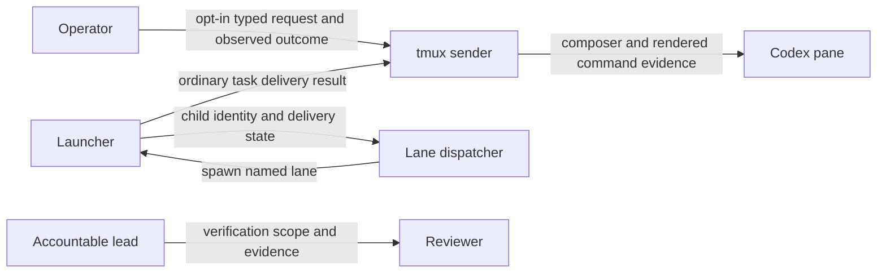

# Field fixes 19

A sender can ask whether a typed Codex `/compact` completed. A caller can
distinguish a launched child with uncertain task delivery from a failed
launch. Reviewers know when intrusive diagnostics require a ruling.
Operators can inspect and steer named work lanes as soon as they launch.

## Goals and scope

| Issue | Owned surface | Published contract |
| --- | --- | --- |
| `tmux-compact-refused-during-turn-20261119` | tmux sender, command tests and transport documentation | [Codex compaction evidence](../../contracts/field-19-compaction.md) |
| `spawn-agent-ambiguous-task-diagnostic-20261119` | launcher task-result wording and its tests | [Launcher task result](../../contracts/field-19-launch-result.md) |
| `verify-lead-tracing-scope-20261119` | verification guidance at the review and role boundaries | [Verification scope](../../contracts/field-19-verification.md) |
| `spawned-lane-dispatch-20261119` | doctrine, dispatch skills and harness bindings | [Named lane dispatch](../../contracts/field-19-dispatch.md) |

This work is bounded to the four field issues. The fork's native watcher,
ordinary sender routes, provider seating and the operator's launch setup
are compatibility constraints. The spec adds zero coordination services.

## Boundary diagram

## Milestones and stop conditions

Freeze and council this spec with its contracts. Exercise one existing
dispatch and verification scenario across the boundaries, publish each
package's acceptance checks, then dispatch four distinct packages in
separate window and worktree pairs. Review pushed package revisions,
run their local gates, merge through normal PRs, and record issue outcomes.

Escalate missing command evidence, scope changes, or launch failures that
leave child identity uncertain. Keep an unconfirmed child available for
inspection and preserve the task's no-replay boundary. A live verification
run that needs an intrusive diagnostic waits for a scoped ruling before the
diagnostic begins. Council findings require a disposition on a later round.

## Interpretations

The four contracts define the observable outcomes. For unsupported pane
layouts, the caller retains an unknown outcome and the existing recovery
rules.
