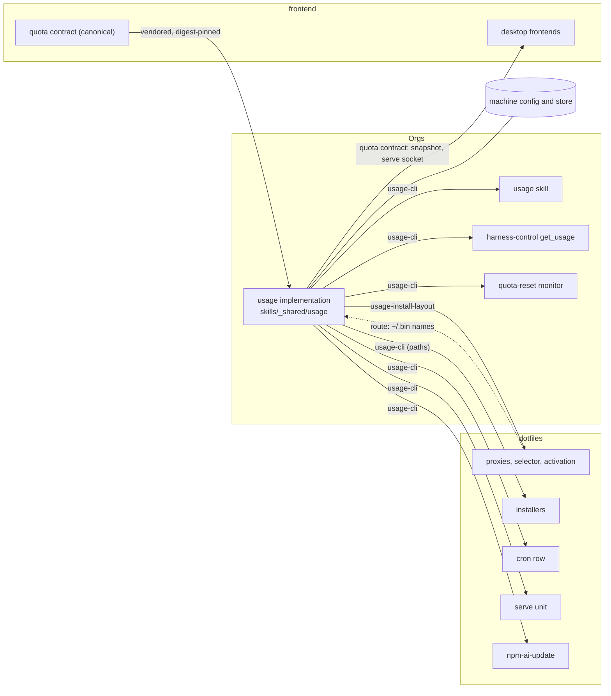

# Usage tooling migration: dotfiles to Orgs

Status: draft spec, 2026-11-28. Nothing here is merged or enabled on any host.
Authority: requested by the CEO through the dotfiles coordinator. Every step
that changes what a host runs needs the dotfiles owner's go and the CEO's.

## Overview

The usage tooling is the code that counts tokens per agent session, reads
provider quota meters, raises the token tripwire and, once two in-review
changes land, serves the quota snapshot. It lives in the private dotfiles
repository under `scripts/usage/`. Orgs already depends on it: the `usage`
skill, `harness-control`'s `get_usage`, the quota-reset monitor and the
doctrine's task-boundary ritual all read its CLI.

This spec moves the implementation into Orgs and leaves dotfiles as the
install layer, the split the search guard already uses: Orgs owns the code
under `skills/_shared/`, dotfiles keeps the installed entry points and the
installers.

### Assumptions

- Orgs is a public repository and so is the frontend repository that owns
  the quota contract. dotfiles is private. Anything pushed to an Orgs branch
  is published, including a draft pull request's commits, and cannot be
  recalled by deleting the branch.
- Hosts reach Orgs code through the managed skills view at
  `~/.claude/skills`, whose `_shared` entry resolves to the Orgs checkout the
  host's installer validated.
- `~/.bin/token-*` are symlinks to entries in the dotfiles checkout's `.bin`
  directory, relinked by every installer run; on some hosts `~/.bin` is that
  directory. The serve unit file is linked from the dotfiles checkout too.
  Pulling dotfiles therefore changes those files with no installer step in
  between.
- `harness-control` runs with `AGENT_SKILLS_ROOT` set to a pinned copy of
  `skills/_shared` from the revision it was built from, not the host's
  checkout.
- The tools are Python 3.11+ standard library only and stay that way.
- The on-disk store and the config file are machine-owned and do not move.
  The store has one format, read and written by both copies during the
  migration.

## Goals and Non-goals

Goals:

1. One implementation of `token-usage`, `token-tripwire` and
   `token-calibrate`, including the quota service, owned and tested in Orgs.
   On a host, every caller runs the same copy.
2. No observable change for any consumer at cutover: same command names on
   `PATH` and in `~/.bin`, same subcommands, flags, output and exit codes,
   same config and state paths, same cron row and unit behaviour.
3. Nothing private is published: no real session, request or rollout ids,
   hostnames, user names, home paths, project or worktree names, pane ids,
   or figures measured on a real host, in any pushed commit.
4. A host can be switched back to the dotfiles copy by one command, with
   no store migration in either direction, until the dotfiles copy is
   removed.
5. The in-review quota-service work lands where it is being reviewed and is
   imported at its merged head. It is not restarted or rebased onto this
   move.

Non-goals:

- No behaviour change, refactor, rename or new feature in the moved code,
  except the `paths` subcommand named below, which lands in dotfiles before
  the import.
- No Nix packaging of the tools.
- The Sui usage analyzers (`sui_*`) do not move.
- Installers, the cron row, the systemd unit file, the selector, the
  installer's ownership records, the machine config and the state store stay
  in dotfiles.
- The quota contract (`quota-snapshot/1`, `quota-observation/1`) is not
  changed. The frontend repository stays its owner.
- Git history of `scripts/usage` is not carried over.

## Firewalled Entities and Contract Boundaries

| Entity | Repository | Owns |
|---|---|---|
| Usage implementation | Orgs, `skills/_shared/usage/` | `token_usage.py`, `tripwire.py`, `calibrate.py`, `quota_service.py`, the vendored `quota_contract.py`, tests, synthetic fixtures, README |
| Install layer | dotfiles | the three entry-point proxies (`.bin/token-*`); the per-host selector and the activation step that sets it; `install-token-tripwire`, `install-quota-service`, the cron row, the `token-usage-serve` unit; machine config and store |
| Quota contract | frontend repository | the canonical validator, its tests and fixtures for `quota-snapshot/1` and `quota-observation/1` |
| Consumers | Orgs, dotfiles, frontend | `usage` skill, `harness-control` `get_usage`, quota-reset monitor; `npm-ai-update`, the cron row, the unit; the desktop frontends |

Boundaries:

- **`usage-cli`** ([contract](../../contracts/usage-cli.md)): the usage
  implementation provides the command line; every consumer depends on it and
  on nothing else. Consumers never import the modules or read the store.
- **`usage-install-layout`**
  ([contract](../../contracts/usage-install-layout.md)): what the install
  layer may assume about the implementation's files, and what it must
  guarantee about activation.
- **Quota contract** (external, existing): between the quota service inside
  the implementation and the frontends, for both `token-usage snapshot` and
  the `serve` socket. Orgs carries the frontend's validator, its copied tests
  and fixtures unchanged, pinned by digest
  `afac23cacb98c580d15999f314a82ffcb8ef858c649a2296703471a24d1f1e52`. A
  contract change is made in the frontend repository first and re-vendored.

### Decisions

- **Location.** `skills/_shared/usage/`. The `usage` skill stays a CLI
  consumer and does not import from it.
- **One switch point per host: the selector.** The three dotfiles `.bin`
  entries become proxies. Each resolves one per-host symlink, the selector,
  at a fixed path under the home directory that no environment variable
  changes, and runs the entry point in the directory it names. The selector
  names either the dotfiles copy or the Orgs copy. While a host has no
  selector, the proxies run the dotfiles copy beside them, so merging and
  pulling the cutover change, and every later installer run, leave the host
  on the code it ran before. Nothing but the activation step creates or
  changes the selector, and no step edits `~/.bin`.
- **Activation is one atomic rename, validated and reversible.** Under an
  exclusive lock, the activation step validates the Orgs copy (the three
  entry points are executable; the five program files are byte-identical to
  the dotfiles copy; `paths` run there by path answers with the expected
  schema and the same values as the installed command under the cron row's
  environment). It records whether the serve unit was active, stops it if
  so, renames a new selector into place, starts the unit again if it was
  active, and checks the result. If the start or a check fails it renames
  the previous selector back, restarts the unit on the previous copy and
  exits nonzero. A command that starts before the rename runs the old copy
  to completion and one that starts after runs the new one; no caller sees a
  mix. Switching back is the same step toward the dotfiles copy and is never
  blocked by the state of the Orgs checkout.
- **One copy per host.** The selector does not depend on
  `AGENT_SKILLS_ROOT` or any other variable, so `harness-control`, the cron
  row, the unit and interactive callers all run the copy it names.
- **What runs follows the checkout, as today.** After activation a host
  runs the usage files of its Orgs checkout, as it ran those of its dotfiles
  checkout before. The migration does not pin a revision per host. What it
  guarantees instead is the freeze below, held by a test in each repository.
- **Fail closed.** A selector that names a missing directory or entry point
  makes the proxy print one line naming the path and the remedy and exit
  127; it never falls back to the other copy. The serve unit must not
  restart-loop on that status. That unit edit reaches hosts on pull and
  takes effect at the next daemon reload; it is behaviour-neutral because
  the status cannot occur before a selector exists.
- **`token-usage paths`.** `install-token-tripwire` and
  `install-quota-service` import `token_usage` to learn the state directory.
  A read-only subcommand replaces those imports. It lands in dotfiles before
  the import, so both copies have it, the installers' tests keep running
  against the dotfiles copy, and the two copies stay byte-identical. It is an
  ordinary dotfiles change that hosts receive on pull: it adds a subcommand
  (so help text and the invalid-subcommand message list one more name) and
  changes how two installers look up a directory.
- **Program files are byte-identical; everything else is audited.** The five
  program files are copied unchanged if the publication audit finds nothing
  private in them. If it finds something, the fix lands in dotfiles first and
  the import is taken from the later commit. The vendored contract validator,
  its copied tests and its fixtures are also unchanged. README, the other
  tests and all other fixtures are rewritten or rebuilt for publication.
- **Publication audit, a named gate (M2a).** Described under Milestones.
- **Both copies are frozen** from the import commit until the dotfiles copy
  is removed. Each repository carries a test pinning the digests of the five
  program files (`token_usage.py`, `tripwire.py`, `calibrate.py`,
  `quota_service.py`, `quota_contract.py`), so no revision of either default
  branch in that window carries an unpaired program file. A fix changes both
  pins: it lands in dotfiles, is ported to Orgs unchanged, and may not change
  the store's format or the config's meaning, so hosts on either revision of
  either copy read each other's store. Activation toward Orgs also compares
  the two copies on the host and refuses if they differ.
- **Gates.** The unit suites and the quota suites become Bazel targets under
  `skills/_shared/usage/` and join `//:portable_tools_test`. The mutation
  checks `tests/mutate_tripwire.py` and `tests/mutate_calibrate.py` are
  separate targets; each must report every mutant killed at the import
  commit and whenever a guard changes.

## Boundary Diagram

Solid edges point from provider to consumer and are labelled with the
contract. The dotted edge is the route for calls made by command name: the
installed names are the proxies, which run the copy the selector names. Two
routes do not use it: the activation step runs the Orgs copy by path to
validate it, and the frontends may read the serve socket.

## Interpretations Log

None yet.

## Milestones

Owners are named. "Go" means the dotfiles owner's and the CEO's explicit
approval. M3 activation and M5 change which copy a host runs and need the
go. M1 and M1b are ordinary dotfiles changes that reach hosts on pull under
the dotfiles owner's own approval.

- **M0. Spec.** This document and its contracts, CLEAN at a formal council
  round. Owner: Orgs.
- **M1. Quota service lands in dotfiles.** The two in-review pull requests,
  both merged. Owner: dotfiles. If either is abandoned or changed in scope,
  the migration stops here and returns to the dotfiles owner and the CEO; no
  partial baseline is imported.
- **M1b. `paths` lands in dotfiles.** `token-usage paths` as the CLI
  contract defines it, with tests; `install-token-tripwire` and
  `install-quota-service` call it instead of importing. Owner: dotfiles,
  drafted by Orgs on request. Acceptance: installer tests pass; `paths`
  reports the `state_dir` the import returned, on the same environment, for
  each config-precedence case; apart from help text and the
  invalid-subcommand message, no other subcommand's output changes.
- **M2a. Publication audit.** Owner: Orgs, with the dotfiles owner's
  sign-off. Done on a local staging tree before anything is pushed to Orgs.
  1. An export inventory lists every file at the import commit with one of:
     copy unchanged, rewrite, rebuild, exclude. The dotfiles owner approves
     it.
  2. Text files marked rewrite are rewritten; the two count fixtures are
     rebuilt from synthetic transcripts with generated ids, synthetic home
     paths and neutral project names, and tests that assert their totals are
     updated. The generator that reads a host's real transcripts is excluded.
  3. A guard scans every file of the staged tree, decompressing compressed
     files, for: UUIDs and request and rollout ids not on a list of
     synthetic ids; `/home/` paths other than the listed synthetic ones;
     hostnames, user names, project and worktree names from a deny list that
     is kept outside Orgs and supplied at run time; pane ids not on the list
     of synthetic ids. Files copied unchanged from the public frontend
     repository are scanned too; their hits are reviewed and, when synthetic,
     added to the lists by the reviewer, never edited. The guard runs
     locally on every commit about to be pushed to the import branch, before
     each push, including pushes that answer review findings.
  4. A fresh reviewer at the Lead tier, with access to both trees, reads the
     staged tree and the guard's output and returns a verdict on publication
     alone. The foreign council seats cannot see the private tree and do not
     substitute for this reviewer.
  5. The audit record (inventory, guard output, reviewer verdict, the
     dotfiles owner's sign-off, the comparison output and the dotfiles
     commit it was taken from) is kept privately and extended before each
     push with the exact Orgs commits it covers. Public records carry only
     the statement that the gate passed and the Orgs commit ids. No dotfiles
     commit id, path listing or comparison output is published.
  Acceptance: zero guard hits, reviewer CLEAN, sign-off recorded. A hit in a
  program file is fixed in dotfiles and the audit restarts from the new
  commit.
- **M2. Import into Orgs.** The audited tree becomes one Orgs pull request.
  Owner: Orgs. Acceptance: the M2a record names the pushed commits; program
  files and the vendored contract files compare equal to the import commit
  (the comparison output goes in the private record); the digest-pin test is
  present; `tests/test_setup_leaks.py` gains an exemption limited to the
  vendored contract test's synthetic home paths, with a test that it applies
  to no other file; all suites and both mutation checks pass; a consumer-driven test feeds the real `posture --no-scan --json` and
  `meters --check --json` output on the synthetic store through
  `harness-control`'s validator and the quota-reset monitor's parser; each
  entry point runs by absolute path through a symlinked directory from an
  unrelated working directory. No host changes. Revert is safe only while no
  host is activated.
- **M3. Cutover.** Owner: dotfiles; Orgs drafts on request. One dotfiles
  pull request: the three `.bin` entries as proxies, the activation step,
  the unit edit named under Decisions, the dotfiles digest-pin test, and the
  layout contract's boundary tests. Merging and pulling it changes no host's
  copy. Then, per host and only with the go:
  1. Update the host's Orgs checkout to a revision containing M2.
  2. Run the activation step toward Orgs. It refuses, changing nothing,
     unless its validation passes.
  3. Evidence, recorded per host in the dotfiles owner's host inventory:
     the selector names the Orgs copy; through the installed names,
     `token-usage paths`, `snapshot --no-scan` and `token-tripwire status`
     exit 0; one `token-tripwire tick` run by the activation step through
     the installed name under the cron row's environment exits 0, its exit
     status is recorded, and the store it wrote is the one `paths` reports;
     the next scheduled tick advances that store with no new error line in
     the cron log; where the unit was active, it is active again, its
     restart count is unchanged afterwards, its main process runs from the
     selected directory, and it answers a snapshot request with a valid
     object; `get_usage` returns a posture.
  Switching back is the same step toward the dotfiles copy. Its evidence is
  the same list with the selector naming the dotfiles copy and the unit's
  process running from it. An interrupted run is completed or reversed by
  rerunning the step: before the rename nothing has changed except a stopped
  unit, which the rerun restarts from its record; after the rename the rerun
  finds the selector in place, restores the unit's recorded state and runs
  the checks.
- **M4. Documents.** No behaviour. Orgs owner: `skills/usage/SKILL.md`, the
  role checklist's wording, the planning note that says the scripts stay in
  dotfiles. Frontend owner: the "where the code lives" section of its spec.
  dotfiles owner: its agent instructions' pointer to the usage README.
  Acceptance: each names the shipped layout.
- **M5. Remove the dotfiles copy.** Owner: dotfiles, with the go. Requires:
  the host inventory lists every host, including ones that were offline;
  each host's selector is re-read at M5 time and names the Orgs copy; each
  has M3 evidence and at least one weekly quota window since with no switch
  back (a minimum the dotfiles owner may extend); the dotfiles commit that
  still holds the copy is recorded as the recovery revision; and a rehearsal
  on one host, starting from the M5 change applied, restores the copy from
  the recovery revision and switches that host back with the switch-back
  evidence. The change removes the program files, their tests, the Bazel
  exports of them and both digest pins' dotfiles side; makes a proxy with no
  selector exit 127 instead of running the removed copy; drops the
  activation step's comparison; and points the installer tests at a stub
  `paths` or a pinned Orgs checkout. It does not remove the proxies, the
  selector, installers, the unit file or anything an enabled host links.

**The two-copy window (M2 to M5).** The dotfiles owner approves any fix; the
Orgs owner ports it and both digest pins change together; the pair of
commits is recorded privately in the dotfiles tracker, and the Orgs tracker
names only the Orgs commit. Changes to the installers, the unit or the
vendored contract in that window are checked against both copies before
they merge. The pins hold the pairing on both default branches; the
activation step's comparison checks it on the host at each activation run.
Between runs a host runs whatever its checkouts carry, which the pins keep
paired and store-compatible.

Stop conditions: a consumer-visible difference at any milestone; a fix in
the two-copy window that would change the store's format; a guard hit
or reviewer finding that cannot be fixed in dotfiles; private data found in a
pushed Orgs commit (stop all pushes, report to the CEO at once; the remedy is
removal of the commits and the pull request's refs by the hosting provider,
and the data is treated as disclosed); the go withheld.

## Open Questions

1. **Which hosts activate, in what order, and when.** Decides: dotfiles
   owner with the CEO. Blocks: M3 activation only.
2. **Soak length before M5.** This spec says one weekly quota window.
   Decides: dotfiles owner. Blocks: M5 only.
