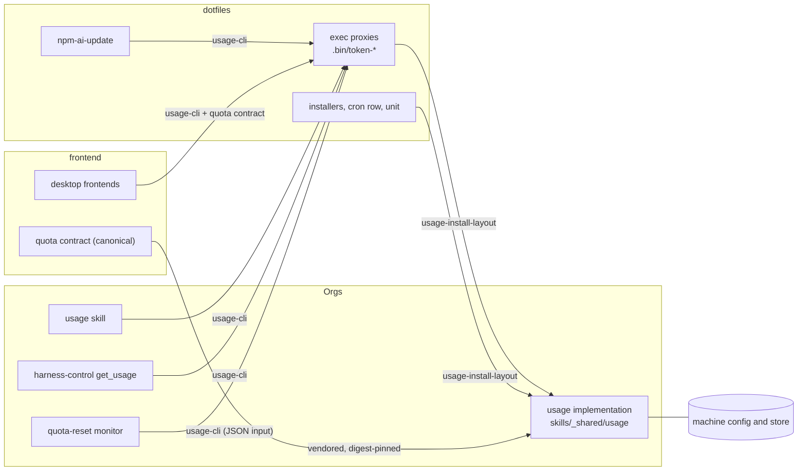

# Usage tooling migration: dotfiles to Orgs

Status: draft spec, 2026-11-28. Nothing here is merged or enabled on any host.
Authority: requested by the CEO through the dotfiles coordinator; every step
that changes installed behaviour needs the dotfiles owner's go and the CEO's.

## Overview

The usage tooling is the code that counts tokens per agent session, reads
provider quota meters, raises the token tripwire and, once two in-flight
changes land, serves the quota snapshot. It lives in the dotfiles repository
under `scripts/usage/`. Orgs already depends on it: the `usage` skill,
`harness-control`'s `get_usage`, the quota-reset monitor and the doctrine's
task-boundary ritual all read its CLI.

This spec moves the implementation into Orgs and leaves dotfiles as the
install layer, the same split the search guard uses: Orgs owns the code under
`skills/_shared/`, dotfiles keeps thin installed entry points and the
installers.

### Assumptions

- Orgs is a public repository. dotfiles is private. Anything that enters
  Orgs is published.
- Hosts reach Orgs code through the managed skills view: the skills root
  (`$AGENT_SKILLS_ROOT`, default `~/.claude/skills`) contains `_shared`,
  which resolves to the Orgs checkout the host's installer validated.
- The tools are Python 3.11+ standard library only and stay that way.
- Two dotfiles pull requests are in review now and add the quota service
  (`snapshot`, `observe`, `serve`) and its installer. They are not restarted,
  rebased onto this move, or blocked by it.
- The on-disk store and the config file are machine-owned and do not move.

## Goals and Non-goals

Goals:

1. One implementation of `token-usage`, `token-tripwire` and
   `token-calibrate`, including the quota service, owned and tested in Orgs.
2. No observable change for any consumer at cutover: same command names on
   `PATH` and in `~/.bin`, same subcommands, flags, output bytes and exit
   codes, same config and state paths, same cron row and unit behaviour.
3. Nothing private is published: no real session ids, request ids, hostnames,
   user names, project or worktree names, or measured figures from a real
   host, in files or in history.
4. Every step is reversible by reverting one dotfiles pull request and
   rerunning the installer, with no store migration in either direction.
5. The in-flight quota-service work lands where it is being reviewed and is
   imported at its merged head.

Non-goals:

- No behaviour change, refactor, rename or new feature in the moved code,
  with one exception named below (`token-usage paths`).
- No Nix packaging of the tools. They are reached through the skills view,
  as the search guard is.
- The Sui usage analyzers (`sui_*`) do not move. They are fleet-specific and
  unrelated.
- Installers, the cron row, systemd units, the adapters list, the machine
  config and the state store stay in dotfiles.
- The quota contract (`quota-snapshot/1`, `quota-observation/1`) is not
  changed here. Its owner stays the frontend repository that authored it.
- Git history of `scripts/usage` is not carried over. It contains fixture
  data derived from real transcripts.

## Firewalled Entities and Contract Boundaries

| Entity | Repository | Owns |
|---|---|---|
| Usage implementation | Orgs, `skills/_shared/usage/` | `token_usage.py`, `tripwire.py`, `calibrate.py`, `quota_service.py`, the vendored `quota_contract.py`, their tests, synthetic fixtures, README |
| Install layer | dotfiles | `.bin/token-usage`, `.bin/token-tripwire`, `.bin/token-calibrate` as exec proxies; `install-token-tripwire`, `install-quota-service`, the cron row, the `token-usage-serve` unit, the adapters list; machine config and store |
| Quota contract | frontend repository | the canonical `contract.py` and its fixtures for `quota-snapshot/1` and `quota-observation/1` |
| Consumers | Orgs, dotfiles, frontend | `usage` skill, `harness-control` `get_usage`, quota-reset monitor; `npm-ai-update`; the desktop frontends |

Boundaries and their contracts:

- **`usage-cli`** ([contracts/usage-cli.md](../../contracts/usage-cli.md)):
  between the usage implementation and every consumer. The command line is
  the API. Consumers never import the Python modules or read the store.
- **`usage-install-layout`**
  ([contracts/usage-install-layout.md](../../contracts/usage-install-layout.md)):
  between the usage implementation and the install layer. Where the entry
  points are under the skills root, what a proxy may assume, and what an
  installer may ask the tool instead of importing it.
- **Quota contract** (existing, external): between the quota service inside
  the usage implementation and the frontends. Orgs vendors a byte-identical
  copy of the canonical validator and pins its digest in a test; a contract
  change is made upstream first and re-vendored.

### Decisions

- **Location.** `skills/_shared/usage/`, beside `skills/_shared/search-guard/`.
  The `usage` skill (`skills/usage/`) remains a consumer of the CLI and does
  not import from `_shared/usage`.
- **Proxy shape.** The three dotfiles entry points become small exec proxies,
  exactly like the search-guard proxy: resolve the skills root, require an
  absolute path and an executable target, `exec` it with the caller's
  arguments. They stop being symlinks into dotfiles' own tree.
- **Fail closed.** When the Orgs implementation is absent, a proxy prints one
  line to stderr naming the missing path and the remedy, and exits 127.
  There is no fallback implementation. Consumers already treat a failing CLI
  as "usage unavailable"; a caller that tests only for the command's
  existence must also check its exit status.
- **Installer gate.** The three entry points join the dotfiles adapters list,
  so an installer run against an Orgs checkout that lacks them refuses to
  link the proxies rather than installing ones that exit 127.
- **`token-usage paths`.** `install-token-tripwire` imports `token_usage` to
  learn the state directory. After the move that import would reach into
  Orgs internals. The one addition this migration makes is a read-only
  subcommand that prints the resolved config and state paths as JSON; the
  installer calls it. It lands in Orgs as its own change after the import.
- **Fixtures.** The two compressed count fixtures are rebuilt from synthetic
  transcripts with generated ids and neutral project names; tests that assert
  totals are updated to the synthetic totals. The fixture generator that
  reads a host's real transcripts is not published. README passages that
  quote measured figures or name hosts and projects are rewritten.
- **Publication guard.** `tests/test_setup_leaks.py` covers the new
  directory, and the import change adds a check that fails on a UUID-shaped
  id not on an allow list of synthetic ids.
- **Gates.** The three unit suites and the two quota suites become Bazel
  targets under `skills/_shared/usage/` and join `//:portable_tools_test`.
  The two mutation checks are separate targets, run when a guard changes and
  before the import is accepted.

## Boundary Diagram

## Interpretations Log

None yet.

## Milestones

Each milestone is one draft pull request unless stated, and each names its
rollback. M3 is the only one that changes installed behaviour.

- **M0. Spec.** This document and its two contracts, CLEAN at a formal
  council round. No code.
- **M1. Quota service lands in dotfiles** (dotfiles owner; two pull requests
  already in review). Not gated on this spec. Stop condition for the
  migration: if either is abandoned, M2 imports dotfiles master without it
  and the quota service is re-proposed against Orgs.
- **M2. Import into Orgs.** Copy `scripts/usage` (without `sui_*`) at one
  recorded dotfiles commit, after M1, into `skills/_shared/usage/`. Program
  files are byte-identical to that commit; the change description lists every
  file that differs and why (fixtures, README, tests that named real
  projects or asserted fixture totals, Bazel wiring). Acceptance: all suites
  and both mutation checks pass in Orgs; the publication guard passes; a
  comparison script shows program files identical to the recorded commit.
  No host changes: nothing installed refers to the new path. Rollback:
  revert the pull request.
- **M2b. `token-usage paths`.** The read-only subcommand and its test, in
  Orgs. Rollback: revert.
- **M3. Cutover in dotfiles** (dotfiles owner). The three `.bin` entries
  become exec proxies; the adapters list gains the three entry points;
  `install-token-tripwire` and `install-quota-service` call the CLI instead
  of importing; an installed-proxies test runs against a synthetic skills
  root. The dotfiles copy of the code stays in place, unused. Precondition:
  no commit touched dotfiles `scripts/usage` program files after the M2
  commit, or each such commit was ported to Orgs first; the pull request
  shows that comparison. Per host: update the Orgs checkout, then run the
  installer. Acceptance per host: `token-usage snapshot --no-scan` and
  `token-tripwire status` succeed through `~/.bin`; the next cron tick
  appends to the same log; the store's files are unchanged in format.
  Rollback: revert this pull request and rerun the installer; the symlinks
  return and the store needs nothing.
- **M4. Consumer and document follow-ups.** Orgs: `usage` skill text, the
  role checklist's wording, the planning note that says the scripts stay in
  dotfiles. Frontend spec: where the service lives. No behaviour.
- **M5. Remove the dotfiles copy** (dotfiles owner), after M3 has run on
  every host for at least one weekly quota window with no rollback. From
  here rollback means restoring the directory from dotfiles history.

Between M2 and M3 two copies exist. The dotfiles copy is the installed one
and is frozen: a fix goes to dotfiles and is ported to Orgs in the same
sitting, and the M3 precondition checks it.

Stop conditions for the whole migration: a consumer-visible difference found
at any milestone; private data found in a pushed Orgs commit (stop, remove
the branch, report to the CEO before anything else); the dotfiles owner or
the CEO withholding the go for M3.

## Open Questions

1. **Who runs M3 on which hosts, and when.** Decides: dotfiles owner with the
   CEO. Blocks: M3 only.
2. **Vendoring direction for the quota contract once the frontend is also
   public.** Options: frontend stays canonical (this spec); Orgs becomes
   canonical and the frontend vendors. Recommendation: no change now.
   Decides: CEO. Blocks: nothing.
3. **Soak length before M5.** This spec says one weekly quota window.
   Decides: dotfiles owner. Blocks: M5 only.
4. **Should the search guard's tests also join the portable suite**, for
   parity with the usage tests? Out of scope here; filed separately.
